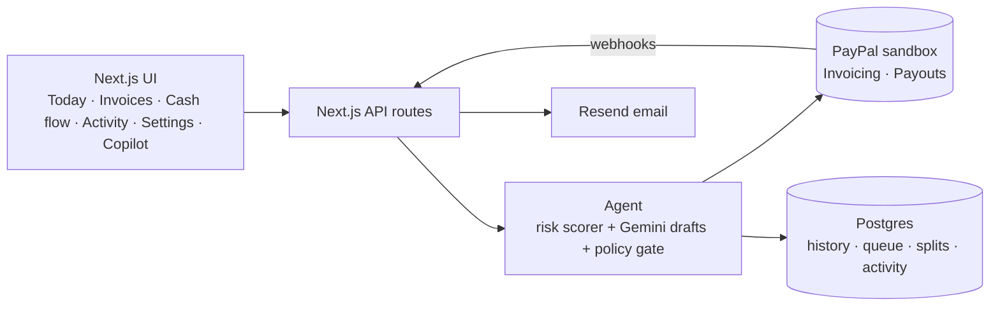

# PayPilot ✈️

**An AI collections and payout copilot for freelancers, built on PayPal.**

Freelancers lose hours every month chasing late invoices, and then split the money with collaborators by hand. PayPilot doesn't just show a dashboard. An AI agent:

- works through your open PayPal invoices
- scores each client's risk of paying late and explains why
- drafts a reminder in a tone that fits that client
- **sends it through PayPal**, on its own when your rules allow and after your approval when they don't

When the client pays, PayPal notifies PayPilot, which **automatically pays your collaborators their share** through PayPal Payouts. Every step is logged with its reason.

> 🔗 **Live demo:** _add your Render URL here_ · 🎥 **Video:** _add your YouTube link here_
>
> Runs entirely on the **PayPal sandbox** (no real money). Client payment histories are **demo data**; every PayPal action (invoices, reminders, payments, payouts) is real sandbox traffic.

---

## Contents

1. [Judge walkthrough](#judge-walkthrough-3-minutes)
2. [Features](#features)
3. [How it works](#how-it-works)
4. [Tech stack](#tech-stack)
5. [Run it locally, step by step](#run-it-locally-step-by-step)
6. [Environment variables](#environment-variables)
7. [npm scripts](#npm-scripts)
8. [Deploy to Render](#deploy-to-render)
9. [Project structure](#project-structure)
10. [API routes](#api-routes)
11. [Troubleshooting](#troubleshooting)
12. [Known limitations](#known-limitations)
13. [License](#license)

---

## Judge walkthrough (3 minutes)

1. Open the live demo, go to **Settings → Reset demo**, and wait about 30 s. This creates 6 real invoices in the PayPal sandbox for 6 demo clients, plus 2 collaborators.
2. On **Today**, click **Run agent**. The agent scores every open invoice and drafts reminders:
   - **Brightline Studio** (low risk, $350) gets a gentle reminder **sent automatically** under the default rules.
   - **Orbit Coffee**, **Acme Corp** and **Kestrel Labs** wait in the approval queue. Each card says *why this tone* and *why it waits for you*.
3. On the **Acme Corp** card, edit the text or switch the tone (the AI redrafts it), then click **Approve & send**. PayPilot writes the message onto the PayPal invoice, triggers PayPal's official reminder and emails the message.
4. Click **Copilot** (top right) and ask:
   - *"Which clients are most likely to pay late?"*
   - *"Invoice Brightline $1,200 for logo work, due in 15 days, split 30% to Maya"*. A real sandbox invoice is created and queued for your approval on **Today**.
5. Pay the Acme invoice as the client. Go to **Invoices**, click the Acme row, then **Pay as client in PayPal**, and log in with the sandbox buyer below.
   - Within a few seconds, **Cash flow** shows Maya ($540) and Leo ($360) paid out automatically, and **Activity** shows the whole chain.
   - If the sandbox checkout gives you trouble, click **Record payment** in the same panel instead. It records the payment on the real PayPal invoice and triggers the same flow.
6. **Invoices** (AG Grid) ranks everything by risk. Click any row to see the score breakdown and edit the collaborator split.

**Sandbox logins for judges** (PayPal sandbox only, no real money):

| Role | Email | Password |
|---|---|---|
| Client (buyer) | _sandbox buyer email_ | _password_ |

Sandbox emails never leave PayPal. You can read them at [developer.paypal.com](https://developer.paypal.com) → **Testing Tools → Sandbox Notifications**.

---

## Features

| | Feature |
|---|---|
| 🧠 | **Risk score (0–100)** worked out by code from days overdue, payment history, ignored reminders, amount vs usual and reminders already sent, with a factor breakdown |
| ✍️ | **AI-drafted reminders** (Google Gemini) in gentle, friendly-firm or firm tone, chosen by the risk score (under 40 / 40–69 / 70+). The AI writes the text and explains the tone; it never invents fees or threats |
| 🛡️ | **Autopilot rules + approval queue**: e.g. "auto-send gentle reminders up to $500 when risk is under 40; ask me for everything else" |
| 📨 | **Real reminder delivery**: AI message written onto the PayPal invoice → PayPal's official reminder → email with a pay link (Resend) |
| 💬 | **Copilot chat**: ask about late payers, draft reminders, create invoices with splits. Every send still goes through your rules |
| 🔔 | **Automatic split payouts** when PayPal reports a payment, via PayPal Payouts. Retries never pay anyone twice, and failed payouts can be retried |
| 🔄 | **Polling backup**: if a webhook is late or missed, the app checks PayPal every 10 s while you're looking at it |
| 📊 | **Invoice risk grid** (AG Grid), **cash flow** view, **client** history and a full **activity log** with reasons |
| 🔁 | **One-click demo reset** that re-seeds the sandbox |

### PayPal APIs used

- **Invoicing v2**: create, send, remind, update (note), get, record payment, cancel, delete draft
- **Payouts v1**: batch payouts to collaborators, batch status
- **Webhooks**: `INVOICING.INVOICE.PAID`, `INVOICING.INVOICE.CANCELLED`, `PAYMENT.PAYOUTSBATCH.*`, `PAYMENT.PAYOUTS-ITEM.*`, with signature verification via `/v1/notifications/verify-webhook-signature`
- **PayPal Agent Toolkit** (`@paypal/agent-toolkit/ai-sdk`): read-only invoice tools for the copilot

### AI

- **Google Gemini** (free tier) through the Vercel AI SDK (`ai@4` + `@ai-sdk/google`). The provider is switchable: set `AI_PROVIDER=anthropic` to use Claude instead
- Structured drafting (`generateObject`) with a 20 s timeout and a safe template fallback, so the agent still works if the AI is down
- A tool-using chat agent (`streamText`, up to 6 steps)
- Design principle: **numbers come from code, words come from the model.** Risk scores, tones and the decision to send or queue are deterministic, so the agent is predictable and auditable.

---

## How it works



1. **Reset demo** creates 6 clients (with demo payment histories), 2 collaborators and 6 real sandbox invoices. Five are open and one is already paid.
2. **Run agent**:
   1. Syncs every invoice from PayPal (the source of truth for status).
   2. Scores each open invoice and picks a tone from the score.
   3. Asks the AI model (Gemini) for a reminder and a one-line explanation.
   4. Passes each reminder through the **policy gate** (your autopilot rules). It is either sent right away or added to the approval queue.
3. **Sending a reminder**:
   1. Writes the AI message onto the PayPal invoice note.
   2. Calls PayPal `/remind`.
   3. Emails the message with the pay link.

   PayPal ignores custom text on reminders, hence the note.
4. **When the client pays**:
   1. PayPal sends `INVOICING.INVOICE.PAID` to `/api/webhooks/paypal`. The app also polls as a backup.
   2. PayPilot confirms the payment with PayPal.
   3. It splits the amount received by your percentages and sends a PayPal Payouts batch.
   4. Payout webhooks update each collaborator's status.

Safety rails:
- Only one open action per invoice is allowed.
- Approving is atomic, so a double click sends once.
- Payouts are unique per invoice and collaborator, so nobody is paid twice.
- All PayPal calls time out after 15 s.
- An action stuck mid-send becomes "failed" with a **Retry** button.

---

## Tech stack

| Layer | Choice |
|---|---|
| App | Next.js 15 (App Router), React 19, TypeScript |
| UI | Tailwind CSS v4, shadcn/ui, AG Grid Community 36, Recharts, lucide icons |
| AI | Google Gemini (free tier) via Vercel AI SDK 4 (`ai`, `@ai-sdk/google`), PayPal Agent Toolkit. Claude supported as an option |
| Payments | PayPal REST APIs (sandbox) |
| Data | Postgres (Neon free tier) + Drizzle ORM |
| Email | Resend |
| Tests | Vitest (71 unit tests) |
| Hosting | Render (Blueprint in `render.yaml`) |

**Everything runs on free tiers:** PayPal sandbox, Google Gemini API, Neon Postgres, Resend, Render and GitHub all have free tiers that cover this project. Every library is open source (AG Grid Community is MIT).

---

## Run it locally, step by step

### 0. Prerequisites

- **Node.js 20 or newer** (22 recommended) and npm
- **Git**
- Free accounts on: [PayPal Developer](https://developer.paypal.com), [Google AI Studio](https://aistudio.google.com), [Neon](https://neon.tech) (or any Postgres), [Resend](https://resend.com)

### 1. Get the code

```bash
git clone https://github.com/vedikaagarwal28/paypilot.git
cd paypilot
npm ci
cp .env.example .env        # Windows PowerShell: Copy-Item .env.example .env
```

### 2. PayPal sandbox setup

1. Log in at [developer.paypal.com](https://developer.paypal.com) and make sure the **Sandbox** toggle is on.
2. Go to **Testing Tools → Sandbox Accounts**:
   - Keep the default **Business** account. This is "you", the freelancer.
   - Click **Create account → Personal** 5 times: **3 buyers** (your clients) and **2 collaborators** (Maya and Leo in the demo).
   - Open each account to see its email and password.
3. Go to **Apps & Credentials → Create App**. Choose type **Merchant** and link it to the sandbox Business account. Copy the **Client ID** and **Secret**.
4. In the app's **Features** section, make sure **Invoicing** and **Payouts** are ticked, then save.
5. Put these in `.env`:
   ```
   PAYPAL_CLIENT_ID=...
   PAYPAL_CLIENT_SECRET=...
   SANDBOX_BUYER_EMAILS=buyer1@...,buyer2@...,buyer3@...
   SANDBOX_COLLAB_EMAILS=maya@...,leo@...
   ```
6. Webhooks need a public URL. See [step 7](#7-optional-receive-paypal-webhooks-locally) for local use or [Deploy to Render](#deploy-to-render). Leave `PAYPAL_WEBHOOK_ID` empty for now.

### 3. AI model (Google Gemini, free)

1. Go to [Google AI Studio → API keys](https://aistudio.google.com/apikey), sign in with a Google account and click **Create API key**. No card is needed for the free tier.
2. Set `GOOGLE_GENERATIVE_AI_API_KEY` in `.env`. Leave `AI_PROVIDER=google`.
3. `GEMINI_MODEL` defaults to `gemini-2.5-flash`. If AI Studio lists a newer free Flash model, use that ID instead.

The free tier is rate-limited. One agent run makes about 4 calls, well within it. If the AI is unreachable or rate-limited, PayPilot keeps working and uses safe template reminders, labelled "template" in the UI.

**Optional, paid:** to use Claude instead, set `AI_PROVIDER=anthropic` and `ANTHROPIC_API_KEY` (from [console.anthropic.com](https://console.anthropic.com)).

### 4. Database (Neon)

Create a free project at [neon.tech](https://neon.tech), copy the connection string (`postgresql://…?sslmode=require`) into `DATABASE_URL`, then create the tables:

```bash
npm run db:push
```

### 5. Email (Resend)

Create an API key at [resend.com](https://resend.com) and set `RESEND_API_KEY`.

- In Resend's test mode, the sender `onboarding@resend.dev` can only deliver to **the email you signed up to Resend with**, so set `DEMO_INBOX_EMAIL` to that address. All demo reminder emails land there.
- To send elsewhere, verify a domain in Resend and change `RESEND_FROM`.

### 6. Check the sandbox, seed the demo, and start

```bash
npm run smoke              # creates + sends a back-dated $10 invoice; prints a payer link
npm run smoke -- payout    # sends a $1 payout to collaborator 1
npm run demo:reset         # creates the demo world in the sandbox (~30 s)
npm run dev                # http://localhost:3000
```

If the smoke test says **back-dated invoice rejected**, set `DEMO_CLOCK_OFFSET_DAYS=30` in `.env`. PayPilot then treats "today" as 30 days later, so invoices with future due dates appear overdue, and a "Demo time +30d" badge shows in the header.

Open http://localhost:3000. On **Today**, click **Run agent**, then follow the [judge walkthrough](#judge-walkthrough-3-minutes).

### 7. (Optional) Receive PayPal webhooks locally

PayPal can't reach `localhost`. Without webhooks, the 10-second polling backup still detects payments and pays collaborators while a page is open. For real webhooks:

1. Start a tunnel: `npx cloudflared tunnel --url http://localhost:3000` (or `ngrok http 3000`).
2. In your PayPal app → **Webhooks → Add Webhook**:
   - URL: `https://<tunnel-host>/api/webhooks/paypal`
   - Events: `INVOICING.INVOICE.PAID`, `INVOICING.INVOICE.CANCELLED`, `PAYMENT.PAYOUTSBATCH.SUCCESS`, `PAYMENT.PAYOUTSBATCH.DENIED`, `PAYMENT.PAYOUTS-ITEM.SUCCEEDED`, `PAYMENT.PAYOUTS-ITEM.FAILED`, `PAYMENT.PAYOUTS-ITEM.UNCLAIMED`
3. Copy the **Webhook ID** into `PAYPAL_WEBHOOK_ID` and restart `npm run dev`.

PayPal's **Webhooks Simulator** sends events that can't be signature-verified. To test with it locally, temporarily set `PAYPAL_WEBHOOK_SKIP_VERIFY=true`. Never do this in a deployed app.

### 8. Run the tests

```bash
npm test
```

---

## Environment variables

All variables live in `.env` (local) or in the Render dashboard (deployed). `.env` is git-ignored; `.env.example` lists every key.

| Variable | Required | Default | What it's for |
|---|---|---|---|
| `PAYPAL_CLIENT_ID` | ✅ | | Sandbox REST app client ID |
| `PAYPAL_CLIENT_SECRET` | ✅ | | Sandbox REST app secret |
| `PAYPAL_WEBHOOK_ID` | for webhooks | | ID of the webhook registered in the PayPal app (used for signature verification) |
| `PAYPAL_API_BASE` | | `https://api-m.sandbox.paypal.com` | PayPal API host. Keep it on sandbox |
| `PAYPAL_WEBHOOK_SKIP_VERIFY` | | `false` | `true` only for local testing with PayPal's simulator |
| `AI_PROVIDER` | | `google` | `google` (Gemini, free tier) or `anthropic` (Claude, paid) |
| `GOOGLE_GENERATIVE_AI_API_KEY` | ✅ | | Gemini API key from Google AI Studio |
| `GEMINI_MODEL` | | `gemini-2.5-flash` | Gemini model ID |
| `ANTHROPIC_API_KEY` | only if `AI_PROVIDER=anthropic` | | Claude API key |
| `ANTHROPIC_MODEL` | | `claude-sonnet-5-5` | Claude model ID |
| `DATABASE_URL` | ✅ | | Postgres connection string |
| `RESEND_API_KEY` | for email | | Resend API key. Without it, reminders still go out through PayPal and the app logs "email not delivered" |
| `RESEND_FROM` | | `PayPilot <onboarding@resend.dev>` | Sender address |
| `DEMO_INBOX_EMAIL` | for email | | Where demo reminder emails are sent (your Resend sign-up email in test mode) |
| `SANDBOX_BUYER_EMAILS` | ✅ | | 3 sandbox Personal account emails, comma-separated (the demo clients) |
| `SANDBOX_COLLAB_EMAILS` | ✅ | | 2 sandbox Personal account emails, comma-separated (the collaborators) |
| `DEMO_CLOCK_OFFSET_DAYS` | | `0` | Shifts "today" forward for demos if the sandbox rejects past due dates |
| `DEMO_PAY_MODE` | | `buyer` | Informational: `record` means you plan to use the **Record payment** button instead of the buyer checkout |
| `APP_URL` | | `http://localhost:3000` | Public URL of the app |

---

## npm scripts

| Command | What it does |
|---|---|
| `npm run dev` | Start the dev server on http://localhost:3000 |
| `npm run build` / `npm start` | Production build and server |
| `npm test` | Run the Vitest unit tests |
| `npm run lint` | ESLint |
| `npm run db:push` | Create or update database tables from `src/lib/db/schema.ts` |
| `npm run demo:reset` | Re-seed the demo in the PayPal sandbox (ignores the 5-minute cooldown the UI button has) |
| `npm run smoke` | Sandbox smoke test: back-dated invoice and payer link |
| `npm run smoke -- payout` | Sandbox smoke test: $1 payout to collaborator 1 |

---

## Deploy to Render

1. Push the repo to GitHub.
2. In [Render](https://render.com): **New → Blueprint**, then pick the repo. `render.yaml` creates a free Node web service with `npm ci && npm run build` / `npm start` and health check `/api/health`.
3. Fill in the secret environment variables Render asks for (same values as your `.env`). Set `APP_URL` to `https://<your-app>.onrender.com`.
4. Create the tables once (from your machine, with `DATABASE_URL` set): `npm run db:push`.
5. In your PayPal app, add a webhook to `https://<your-app>.onrender.com/api/webhooks/paypal` with the events listed in [step 7](#7-optional-receive-paypal-webhooks-locally). Put its ID in Render's `PAYPAL_WEBHOOK_ID` and redeploy.
6. Open the app → **Settings → Reset demo** → **Today → Run agent**.

**Free-tier note:** Render's free services sleep after 15 minutes without traffic and take about a minute to wake. PayPal retries missed webhooks, and the polling backup catches up when you open the app. To stay awake while demoing or judging, ping `https://<your-app>.onrender.com/api/health` every 10 minutes (e.g. with [cron-job.org](https://cron-job.org)).

---

## Project structure

```
src/
  app/                      Pages (Today, Invoices, Cash flow, Activity, Settings, Client) and API routes
  components/               App components (badges, nav, copilot drawer, approval cards, grid, split editor)
    ui/                     shadcn/ui primitives
  lib/
    paypal/                 PayPal REST client: auth, invoicing, payouts, webhook verification
    risk/score.ts           Deterministic 0–100 risk score + tone bands
    policy/gate.ts          Autopilot rules: send now or queue for approval
    splits/compute.ts       Collaborator split maths (rounds down, never over 100%)
    agent/                  AI drafting (Gemini/Claude), triage run, copilot tools and system prompt
    actions/                Request / execute / skip / retry queued actions (atomic, idempotent)
    payments/on-paid.ts     Payment confirmed → split payouts (idempotent), payout retry
    sync/                   PayPal → DB sync and the 10 s polling backup
    demo/                   Demo seed data and reset
    db/                     Drizzle schema and client
    queries/                Read models for the pages
scripts/                    smoke.ts, reset-demo.ts
tests/                      Vitest unit tests
docs/superpowers/           Design spec and implementation plan
render.yaml                 Render Blueprint
```

---

## API routes

| Method | Route | Purpose |
|---|---|---|
| GET | `/api/health` | Health check |
| GET | `/api/dashboard` | Today page data (also triggers the polling sync) |
| POST | `/api/agent/run` | Run the triage agent (409 if one is already running) |
| PATCH | `/api/actions/:id` | `{ op: "approve" \| "skip" \| "retry", subject?, body? }` |
| POST | `/api/actions/:id/redraft` | `{ tone }`: rewrite a queued reminder in a new tone |
| GET | `/api/invoices` | Invoice grid rows |
| POST | `/api/invoices/:id/remind` | Draft a reminder for one invoice (goes through the rules) |
| PUT | `/api/invoices/:id/splits` | `{ splits: [{ collaboratorId, percent }] }` |
| POST | `/api/invoices/:id/record-payment` | Record an off-PayPal payment on the sandbox invoice |
| GET | `/api/cashflow` | Cash flow tiles, weekly chart, payouts (also triggers the polling sync) |
| POST | `/api/payouts/retry` | `{ invoiceId }`: retry failed payouts |
| GET | `/api/activity?actor=` | Activity log |
| GET / PUT | `/api/settings` | Autopilot rules |
| GET / POST / PUT | `/api/collaborators` | Collaborators |
| POST | `/api/demo/reset` | Reset the demo (429 within 5 minutes of the last reset) |
| POST | `/api/chat` | Copilot chat (streaming) |
| POST | `/api/webhooks/paypal` | PayPal webhook receiver (signature-verified) |

---

## Troubleshooting

| Symptom | Fix |
|---|---|
| `ZodError` / "Required" on startup | A required env var is missing. Compare `.env` with the table above |
| Smoke test: **back-dated invoice rejected** | Set `DEMO_CLOCK_OFFSET_DAYS=30` |
| Payout fails with `AUTHORIZATION_ERROR` | Tick **Payouts** in your PayPal app's Features, save, wait a minute |
| Payout fails with `INSUFFICIENT_FUNDS` | The sandbox Business account needs balance. Have a buyer pay an invoice first, or add funds in the sandbox account settings. Then click **Retry** on **Cash flow** |
| Reminders show "(PayPal only)" | Resend isn't set up, or `DEMO_INBOX_EMAIL` isn't your Resend sign-up email |
| Drafts are labelled "template" | The AI was unreachable, rate-limited, or `GOOGLE_GENERATIVE_AI_API_KEY` / `GEMINI_MODEL` is wrong. The app keeps working with templates |
| Webhooks return 401 | `PAYPAL_WEBHOOK_ID` doesn't match the webhook PayPal is calling |
| Paid invoice not showing as paid | Keep the Today or Cash flow page open; the polling backup checks PayPal every 10 s |
| "Demo was reset less than 5 minutes ago" | The UI has a 5-minute cooldown; wait, or run `npm run demo:reset` |
| An approval card is stuck on "sending" | After 2 minutes it turns into "failed" with a **Retry** button |

---

## Known limitations

- **Sandbox only, no login.** This is a hackathon demo: there is a single shared workspace with no authentication, so anyone with the URL can use it. Don't put real credentials in it.
- Client payment histories are synthetic demo data (marked **Demo data** in the UI).
- Splits are worked out on the amount received before PayPal fees.
- USD only.

---

## License

[MIT](LICENSE)
