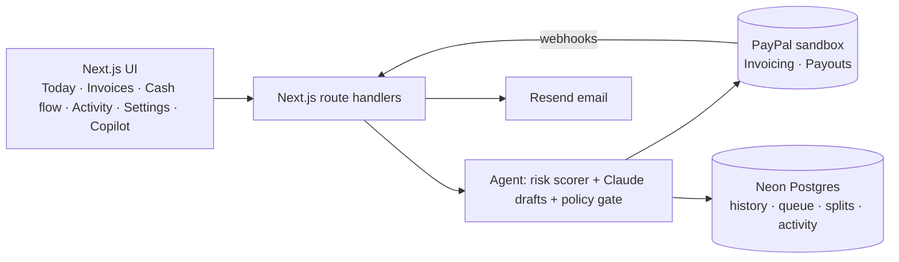

# PayPilot ✈️

**An AI collections and payout copilot for freelancers, built on PayPal.**

Freelancers lose hours every month chasing late invoices, and then split the money with collaborators by hand. PayPilot doesn't just show a dashboard. An AI agent:

- works through your open PayPal invoices
- scores each client's risk of paying late and explains why
- drafts a reminder in a tone that fits that client
- **sends it through PayPal**, on its own when your rules allow and after your approval when they don't

When the client pays, a PayPal webhook triggers **automatic split payouts** to your collaborators through PayPal Payouts. Every step is logged with its reason.

> 🔗 **Live demo:** _add your Render URL here_ · 🎥 **Video:** _add your YouTube link here_
> Runs entirely on the **PayPal sandbox**. Client payment histories are **demo data**; every PayPal action is real.

---

## Judge walkthrough (3 minutes)

1. Open the live demo, go to **Settings → Reset demo**, and wait about 30 s. This creates 6 real invoices in the PayPal sandbox.
2. On **Today**, click **Run agent**. The agent scores every invoice and drafts reminders:
   - **Brightline Studio** (low risk, $350) gets a gentle reminder **sent automatically** under the default rules.
   - **Orbit Coffee**, **Acme Corp** and **Kestrel Labs** wait in the approval queue. Each card says *why this tone* and *why it waits for you*.
3. On the Acme card, edit or re-tone the message, then click **Approve & send**. PayPilot writes the message onto the PayPal invoice, triggers PayPal's official reminder and emails the client.
4. Open **Copilot** (top right) and ask *"Which clients are most likely to pay late?"*, then *"Invoice Brightline $1,200 for logo work, due in 15 days, split 30% to Maya"*. A real sandbox invoice is created and queued for approval.
5. Pay the Acme invoice as the client: on **Invoices**, click the PayPal link on the Acme row and log in with the sandbox buyer below. Within seconds, **Cash flow** shows Maya ($540) and Leo ($360) paid out automatically, and **Activity** shows the whole chain.
6. **Invoices** (AG Grid) ranks everything by risk. Click a row to see the factor breakdown and edit the split.

**Sandbox logins for judges** (PayPal sandbox only, no real money):

| Role | Email | Password |
|---|---|---|
| Client (buyer) | _sandbox buyer email_ | _password_ |

Sandbox emails never leave PayPal. You can see them under Developer Dashboard → Sandbox → Notifications.

---

## Features

| | Feature |
|---|---|
| 🧠 | **Deterministic risk score (0–100)** from days overdue, payment history, ignored reminders, amount vs usual and reminders already sent, with a factor breakdown |
| ✍️ | **AI-drafted reminders** (Claude) in gentle, friendly-firm or firm tone, chosen by the risk band. The AI writes the text and explains the tone; it never invents fees or threats |
| 🛡️ | **Autopilot rules + approval queue**: e.g. "auto-send gentle reminders under $500 when risk < 40; ask me for everything else" |
| 📨 | **Real reminder delivery**: AI message written onto the PayPal invoice → PayPal `remind` → email with pay link (Resend) |
| 💬 | **Copilot chat**: ask about late payers, draft reminders, create invoices with splits. Every send still goes through your rules |
| 🔔 | **Webhook → automatic split payouts** via PayPal Payouts. Idempotent, so retries never pay anyone twice |
| 📊 | **Invoice risk grid** (AG Grid), **cash flow** view, **client** history, full **activity log** |
| 🔁 | **One-click demo reset** that re-seeds the sandbox |

## PayPal APIs used

- **Invoicing v2**: create, send, remind, update (note), get, record payment, cancel, delete draft
- **Payouts v1**: batch payouts to collaborators, batch status
- **Webhooks**: `INVOICING.INVOICE.PAID`, `INVOICING.INVOICE.CANCELLED`, `PAYMENT.PAYOUTSBATCH.*`, `PAYMENT.PAYOUTS-ITEM.*`, with signature verification via `verify-webhook-signature`
- **PayPal Agent Toolkit** (`@paypal/agent-toolkit/ai-sdk`): read-only invoice tools for the copilot

## AI

- **Claude** via the Vercel AI SDK (`ai@4` + `@ai-sdk/anthropic`)
- Structured drafting (`generateObject`) with a 20 s timeout and a safe template fallback
- A tool-using chat agent (`streamText`, max 6 steps)
- Design principle: **numbers come from code, words come from the model.** Risk scores, tones and the decision to send or queue are deterministic, so the agent is predictable and auditable.

## Architecture



## Tech stack

Next.js 15 · React 19 · TypeScript · Tailwind v4 + shadcn/ui · Vercel AI SDK 4 + Claude · PayPal Agent Toolkit · Drizzle ORM + Neon Postgres · AG Grid Community · Recharts · Resend · Vitest · Render

---

## Run it yourself

**Prerequisites:**
- Node 20+
- A PayPal developer account with a sandbox REST app (Invoicing + Payouts enabled), 1 business account, 3 personal "buyer" accounts and 2 personal "collaborator" accounts
- An Anthropic API key
- A Neon (or any) Postgres database
- A Resend API key

```bash
git clone https://github.com/vedikaagarwal28/paypilot.git
cd paypilot
npm ci
cp .env.example .env        # fill in every value
npm run db:push             # create tables
npm run demo:reset          # seed the sandbox (6 invoices, 2 collaborators)
npm run dev                 # http://localhost:3000
npm test                    # unit tests
npm run smoke               # optional sandbox smoke test
```

**Webhooks locally:** PayPal needs a public URL. Use a tunnel (`cloudflared tunnel --url http://localhost:3000` or ngrok) and register `<tunnel>/api/webhooks/paypal` in your PayPal app. Without one, the agent's sync on **Run agent** still picks up paid invoices and triggers payouts.

**Deploy:** `render.yaml` is a Render Blueprint. Create it from the repo, fill in the secret env vars, then register `https://<app>.onrender.com/api/webhooks/paypal` as the PayPal webhook and put its ID in `PAYPAL_WEBHOOK_ID`.

**Demo knobs:**
- `DEMO_CLOCK_OFFSET_DAYS` shifts "today" forward if your sandbox rejects back-dated invoices.
- `DEMO_INBOX_EMAIL` is where reminder emails land. In Resend test mode this must be your Resend account's email.

## License

[MIT](LICENSE)
